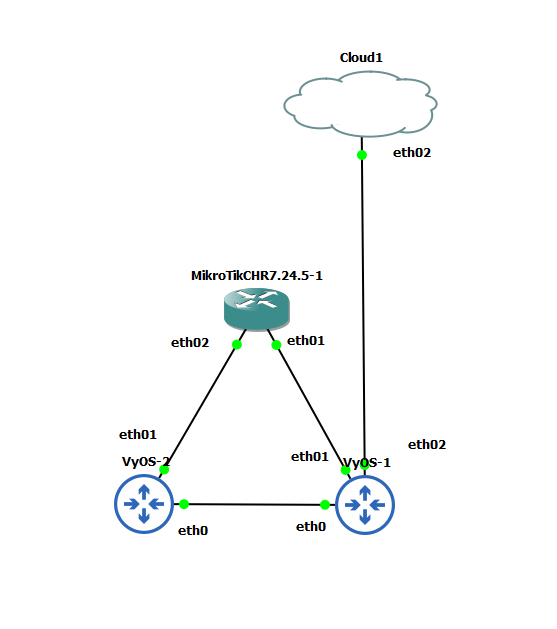
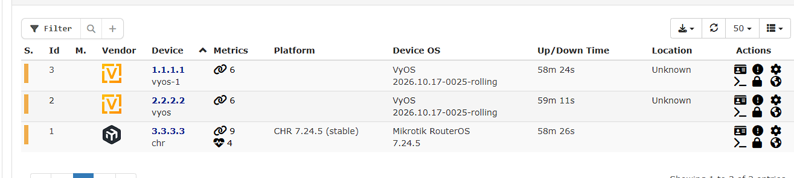
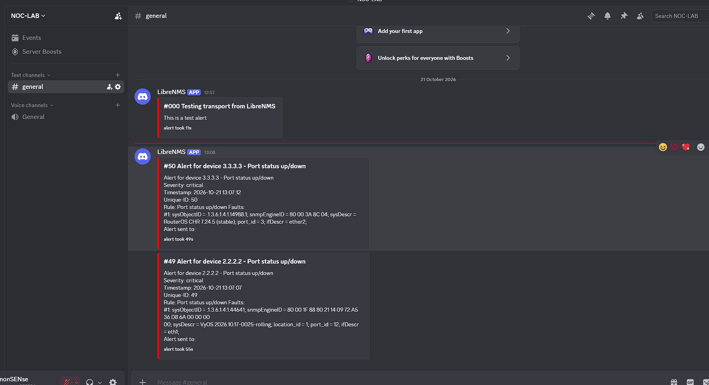
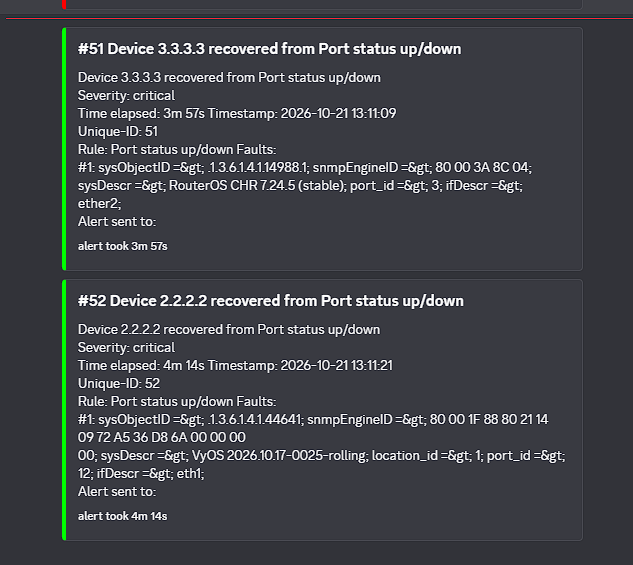
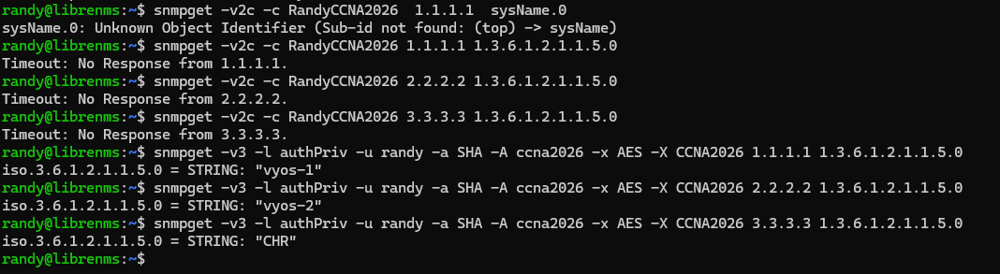
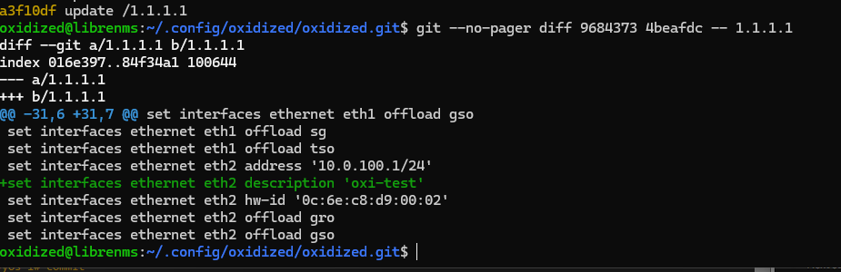

# NOC Monitoring Lab

A home lab where I monitor three routers with LibreNMS, get Discord alerts when something breaks, collect their logs, and keep a version history of every router config.

I built this after passing my CCNA. I wanted to practice what a NOC actually does every day: watch the network, catch problems fast, get notified, and work out what changed.

---

## What I built

- 3 virtual routers running in GNS3
- A LibreNMS server that checks them every 5 minutes
- Alerts that go to a Discord channel when a link goes down, and again when it comes back
- Syslog from every router sent to LibreNMS, with alert rules built on the log messages
- SNMPv3 (authentication and encryption) instead of SNMPv2c
- Automatic config backups with Oxidized, stored in Git so every change shows up as a diff

---

## Tools I used

| What | Used for |
| --- | --- |
| GNS3 + VMware Workstation | Running the lab |
| MikroTik CHR 7.24.5 | Router 1 |
| VyOS (rolling) x2 | Router 2 and Router 3 |
| LibreNMS on Ubuntu | The monitoring server |
| SNMP v2c, then SNMPv3 | How LibreNMS talks to the routers |
| rsyslog | Receiving router logs |
| Oxidized | Config backups and diffs |
| Discord webhook | Where alerts get sent |

---

## How it's connected

The three routers are connected in a triangle running OSPF. LibreNMS sits on its own network and reaches the lab through VyOS-1.

| Device | Monitored IP (loopback) |
| --- | --- |
| VyOS-1 | 1.1.1.1 |
| VyOS-2 | 2.2.2.2 |
| MikroTik CHR | 3.3.3.3 |

The LibreNMS server has two network cards:

- One for internet and my browser (NAT)
- One for the lab (`10.0.100.10`), which is the one that talks to the routers

I monitor each router by its loopback IP. A loopback stays up as long as the router is alive, so if one link breaks, LibreNMS doesn't think the whole router died.

---

## How I set it up

### 1. Install LibreNMS

I installed LibreNMS on an Ubuntu VM with nginx, PHP, and MariaDB. Then I finished the setup in the web installer and ran `validate.php` to check everything. All checks passed.

### 2. Turn on SNMP on the routers

I started with SNMPv2c: a read-only community on each router, allowed only from the LibreNMS server (`10.0.100.10`). On the MikroTik I also disabled the default `public` community, because it was open to everyone. I later replaced all of this with SNMPv3.

### 3. Add the routers to LibreNMS

I added all three using their loopback IPs. After the first poll, LibreNMS showed the router type, version, ports, and uptime.

### 4. Set up Discord alerts

- Made a webhook in my Discord server
- Added it to LibreNMS as an alert transport
- Created an Operation (the delivery plan) and attached it to the rules I care about:
  - Port status up/down
  - Device down (SNMP)
  - Device down (no ping)

---

## The test

To prove it works, I cut a link on purpose.

1. I suspended the link between the MikroTik and VyOS-2 in GNS3 (like pulling the cable).
2. LibreNMS caught it and showed two faults, one for each end of the link.
3. Two alerts arrived in Discord.
4. I resumed the link.
5. Two recovery messages arrived in Discord.

It took about 4 minutes each way, because LibreNMS checks every 5 minutes.

**Link down:**

**Link back up:**

---

## Going further

### Syslog and log-based alerts

The routers send syslog from their loopbacks to the LibreNMS server. I wrote alert rules on the log text, so a config commit or an OSPF neighbor going down produces a Discord alert within about a minute.

### SNMPv3

I replaced SNMPv2c with SNMPv3 `authPriv` (SHA authentication, AES privacy) on all three routers.

A packet capture on UDP 161 shows encrypted payloads and no community string. I removed the v2c communities and checked: v2c queries time out, v3 queries succeed. Each router has its own engine ID, following a template (24 hex digits ending in the device number).

### Config backup with Oxidized

Oxidized logs in to each router over SSH with a dedicated, limited account, pulls the config, and commits every change to Git. The device list comes from LibreNMS, so there is only one inventory. It runs as a service and starts on boot.

To test it, I made a one-line change on VyOS-1. Oxidized recorded it as a diff, and the revert was recorded as well.

---

## Troubleshooting tickets

Each ticket was a fault injected into the lab, which I diagnosed from the symptoms only.

| Ticket | Symptom | Root cause | How I found it |
| --- | --- | --- | --- |
| #1001 | Syslog from VyOS-1 not arriving | Wrong syslog port | `tcpdump` on the LibreNMS server |
| #1002 | Discord alerts not delivered | Invalid webhook token | HTTP 401 in the LibreNMS Eventlog |
| #2001 | VyOS-1 down in LibreNMS, ping and OSPF fine | SNMPv3 auth password changed | Compared against saved config hash |
| #2002 | CHR SNMP unreachable, "credentials unchanged" | Privacy protocol changed from AES to DES | The CHR's own syslog recorded the change |
| #2003 | VyOS-2 stopped polling, user lines unchanged | Engine ID changed, which breaks the SNMPv3 keys | Compared against the saved config |

---

## Problems I ran into (and how I fixed them)

1. **LibreNMS refused to add my second VyOS router.**
   It said "duplicate sysName". Both routers were named `vyos`, and LibreNMS uses the name to tell devices apart. I renamed them to `vyos-1` and `vyos-2` and it worked.

2. **My alerts weren't being sent anywhere.**
   In this newer version of LibreNMS, a rule can't pick a transport directly. You have to create an Operation first, then attach it to the rule. Before that, the Operation dropdown was empty.

3. **Too many alerts at once.**
   The first time I tested, LibreNMS alerted on every port without a cable too, so I couldn't see the real problem. I turned off the unused ports on the routers, and then only the real link showed up.

4. **Wrong IP in the SNMP allow-list.**
   I first used the server's internet-side IP. The routers never see that IP, because the traffic comes from the lab-side card (`10.0.100.10`). Once I used the right one, polling worked.

5. **Syslog messages not matching the right device.**
   Reverse DNS on the loopback addresses broke the host matching in rsyslog. Matching on the source IP instead fixed it.

6. **Same symptom, different cause.**
   A wrong SNMPv3 password and a changed engine ID give the same polling failure. Comparing against a saved config told them apart.

---

## What I learned

- How SNMP polling works, and why the source IP matters
- Why monitoring a loopback is better than a physical interface
- How to read a LibreNMS alert and match it to the real problem
- How to test an alert chain from start to finish: fault, alert, recovery
- Why SNMPv3 beats v2c, and how its keys depend on the engine ID
- How a config backup with diffs turns "something changed" into a specific line and time
- Troubleshooting step by step instead of guessing

---

## What I want to add next

- A network map in LibreNMS (needs LLDP on the routers)
- Alerts for high CPU and interface traffic
- Email as a second alert option

---

## Security notes

- This repository contains no passwords, tokens, community strings, or config exports
- The lab passwords and API token were changed after setup
- The Oxidized backup account is separate from the admin accounts

---

## About me

I'm Randy. I passed the CCNA in October 2026 and I'm looking for a NOC role. I'm open to shift and night work.

- GitHub: [Kioski22](https://github.com/Kioski22)
- LinkedIn: [randy-flores-879140363](https://www.linkedin.com/in/randy-flores-879140363)
- CCNA labs: [CCNA-LABS-portfolio](https://github.com/Kioski22/CCNA-LABS-portfollio)